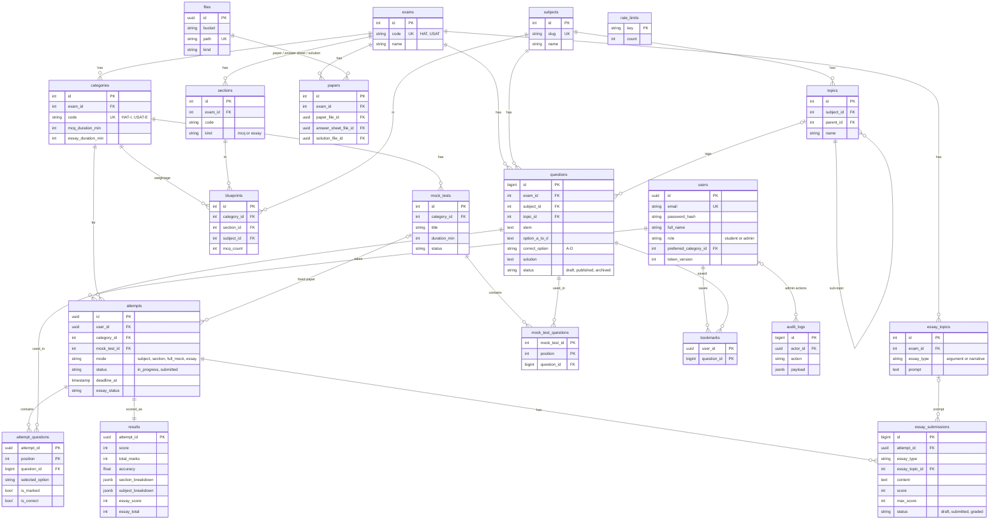

# QADAM (قدم)

QADAM is a free website where Pakistani students prepare for the **HAT** and **USAT** entry tests. A student picks a test and a category, then:

- takes a **full mock test** with the real timer and the official number of questions from each subject,
- practises **one section** at a time, or **one subject** inside a section that has several subjects, such as Physics in "Category Subjects" (there is no topic-wise practice, because each topic has only a few questions),
- writes the two **USAT essays**, either by typing them or by writing on paper and giving themselves a score (75%, 85% or a random 70–90%),
- sees a **result** with the score by section and subject, the correct answers and a solution for each question.

Admins add questions (one by one, or by importing CSV, Excel, PDF, Word or text files), and can **edit, publish/unpublish or delete** any question from the question list. Deleting a question that students have already used archives it instead, so old results stay correct. Admins also build fixed mock papers, grade typed essays and manage students.

---

## 1. Frontend (what the student sees)

| What | Used | Why, in simple words |
|---|---|---|
| Framework | **Next.js 16** with React 19 | Builds the pages. Most pages are made on the server, so phones get a ready page quickly. |
| Language | **TypeScript** | JavaScript that checks types, so fewer bugs slip through. |
| Styling | **Tailwind CSS 4** | Styles are written as short class names. All colours live in one file: `frontend/app/globals.css`. |
| Icons | **Lucide** | Simple line icons. |
| Fonts | **Plus Jakarta Sans** for English, **Noto Nastaliq Urdu** for Urdu | Both are served by Next.js itself, not by Google. The Urdu font is large (about 160 KB), so it is not preloaded and only downloads on pages that show Urdu. |

**Design.** The look is clean and plain, so students don't have to work out how to use it.

- **Colours:** the main colour is the deep green of the Pakistan flag (`#01411c`), on white and a light cool grey. A warm amber is used only for small highlights, such as a marked question.
- **Urdu:** a few short Urdu phrases appear in Nastaliq script on the landing page and dashboard, for example "آپ کا اگلا قدم یہیں سے شروع ہوتا ہے" and "السلام علیکم، خوش آمدید", so the site feels made for Pakistani students.
- **Phones and slow networks:** every page works on a phone. The exam screen saves answers as the student goes, so a dropped connection does not lose work.

**Main folders**

```
frontend/
├── app/            pages (public, login/register, student, admin, exam screen)
├── components/     shared pieces: buttons, cards, header, logo
├── features/       bigger parts: exam engine, essays, practice panel, admin forms
└── lib/            talking to the API, helpers
```

The browser only talks to the frontend. Requests to `/api/v1/*` are passed on to the backend, so the login cookie stays safe and there are no CORS problems.

## 2. Backend (the server)

| What | Used | Why, in simple words |
|---|---|---|
| Language | **Python 3.13** | |
| Web framework | **FastAPI** | Fast and simple, and it checks every request automatically. |
| Data checking | **Pydantic 2** | Describes what each request and response must look like. |
| Database access | **SQLAlchemy 2** (async) + **asyncpg** | Reads and writes PostgreSQL from Python. |
| Database changes | **Alembic** | Keeps a history of table changes ("migrations"). |
| Login | password hashing (bcrypt) + a signed token in an httpOnly cookie | Passwords are never stored as plain text. |
| File reading | parsers for PDF, DOCX, DOC, TXT, CSV and Excel | Turns uploaded question papers into MCQs. |

**How the code is arranged:** `api/routes` receives a request → `services` does the work → `models` are the database tables.

```
backend/
├── api/routes/     URLs (auth, catalog, attempts, results, admin)
├── services/       the real logic (mocks, scoring, essays, imports)
├── models/         database tables
├── schemas/        request/response shapes
├── migrations/     Alembic history
├── scripts/        seed data, create admin, checks
└── tests/          pytest tests
```

**Timers are on the server.** The server stores the deadline of each mock, so refreshing the page or changing the phone clock cannot add time.

## 3. Database, files and hosting

| What | Used |
|---|---|
| Database | **PostgreSQL** on **Supabase** |
| Files (question images, papers, answer sheets) | **Supabase Storage** |
| Hosting | **Vercel**: two projects from this one repository, `frontend/` and `backend/` |
| Checks on every push | **GitHub Actions** (`.github/workflows/ci.yml`) |

## 4. Run it on your computer

You need Python 3.13, Node 22+ and a PostgreSQL URL (Supabase or local).

```bash
# Backend
cd backend
python -m venv .venv
.venv/Scripts/activate              # Windows (macOS/Linux: source .venv/bin/activate)
pip install -r requirements-dev.txt
cp .env.example .env                # fill DATABASE_URL, DATABASE_URL_MIGRATIONS, SECRET_KEY
alembic upgrade head                # create the tables
python -m scripts.seed              # HAT/USAT categories, sections, subjects, weightage
python -m scripts.create_admin --email you@example.com --name "Your Name"
uvicorn main:app --reload --port 8000

# Frontend (new terminal)
cd frontend
npm install
cp .env.example .env.local          # API_PROXY_TARGET=http://127.0.0.1:8000
npm run dev                         # open http://localhost:3000
```

**Checks before you push**

```bash
cd backend  && ruff check . && pytest -q     # pytest needs TEST_DATABASE_URL (a throwaway database, it gets wiped)
cd frontend && npm run typecheck && npm run lint && npm run build
```

## 5. Deploy

1. On Vercel, create a project from this repo with root `backend`. Set `DATABASE_URL` (Supabase **transaction pooler**, port 6543), `SECRET_KEY` and `ENVIRONMENT=production`.
2. Open `https://<api>/api/v1/health/db`. It should say `connected`.
3. Create a second project with root `frontend`. Set `API_PROXY_TARGET=https://<api>.vercel.app` **before** the first build.
4. Run `alembic upgrade head` from your own computer whenever the tables change. Vercel does not run migrations.

## 6. Common problems

| Problem | Fix |
|---|---|
| Vercel says `Invalid requirement` | `requirements.txt` was saved as UTF-16 by PowerShell. Run `python scripts/check_requirements.py requirements.txt`. |
| `could not translate host name db.<ref>.supabase.co` | Use the Supabase **pooler** URL, not the direct one. |
| A student sees no questions | The questions must be **published**, and their subject must belong to that category. |

---

## 7. Database schema (ERD)

The tables in simple words:

- **users**: students and admins.
- **exams → categories → blueprints**: HAT/USAT, their categories (e.g. HAT-I, USAT-E), and how many MCQs of each subject a full mock has.
- **sections, subjects, topics**: how questions are grouped.
- **questions**: the MCQ bank (4 options, correct answer, solution).
- **attempts, attempt_questions, results**: every test a student takes, each answer they gave and the final score.
- **essay_topics, essay_submissions**: USAT essay prompts and what students wrote (or self-scored).
- **mock_tests, mock_test_questions**: fixed mock papers made by an admin.
- **files, papers**: uploaded papers, answer sheets and solutions.
- **bookmarks, audit_logs, rate_limits**: saved questions, a log of admin actions, and login/request limits.


